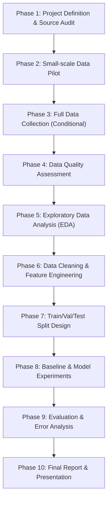

# Điều Lệ Dự Án (Project Charter)

- **Tên đề tài**: Dự đoán giá rao bán ô tô đã qua sử dụng tại Việt Nam bằng Machine Learning
- **Tên tiếng Anh**: Used Car Price Prediction in Vietnam: An End-to-End Machine Learning Project
- **Phiên bản tài liệu**: 1.0 (Phase 0 — Project Definition & Source Feasibility)
- **Ngày phê duyệt tài liệu**: 18/10/2026 (Múi giờ: Asia/Ho_Chi_Minh)
- **Vai trò**: Cố vấn kỹ thuật (Senior Data Scientist & ML Mentor) & Sinh viên thực hiện (AI Member)

---

## 1. Tuyên Bố Bài Toán (Problem Statement)

### 1.1. Bối cảnh thực tế
Thị trường ô tô đã qua sử dụng tại Việt Nam là một thị trường phi tập trung, bất đối xứng thông tin cao giữa người bán (cá nhân, salon, môi giới) và người mua. Việc định giá một chiếc xe cũ phụ thuộc vào rất nhiều yếu tố phi tuyến: khấu hao theo thời gian, số kilomet đã lăn bánh (ODO), uy tín thương hiệu, phân khúc xe, kiểu dáng, nguồn gốc xuất xứ và sự biến động theo khu vực địa lý.

### 1.2. Vấn đề kỹ thuật cần giải quyết
Xây dựng một hệ thống học máy có giám sát (Supervised Regression Pipeline) có khả năng ước lượng mức giá rao bán hợp lý (`price_vnd`) của một chiếc xe ô tô đã qua sử dụng dựa trên các thông số kỹ thuật và thuộc tính thị trường được công bố công khai.

### 1.3. Đối tượng sử dụng kết quả
- **Người mua xe cá nhân**: Tham khảo khoảng giá hợp lý trên thị trường rao vặt để tránh mua phải xe bị đội giá quá cao.
- **Người bán xe / Chủ xe**: Thiết lập mức giá chào bán cạnh tranh, phù hợp với thanh khoản thị trường.
- **Thành viên CLB AI & Học viên**: Nắm vững phương pháp luận xây dựng một dự án End-to-End ML chuẩn mực từ dữ liệu thực tế tại Việt Nam.

### 1.4. Phân biệt then chốt: Giá rao bán (Listing Price) vs. Giá giao dịch thực tế (Transaction Price)
> [!IMPORTANT]
> **Đây là ranh giới khái niệm bắt buộc phải phân biệt rõ ràng:**
> - **Giá rao bán (Listing / Asking Price)**: Là mức giá kỳ vọng được người bán niêm yết công khai trên sàn thương mại điện tử. Mức giá này thường bao gồm biên độ thương lượng (thương lượng giảm 2% - 5%), chi phí quảng cáo tin, hoặc tâm lý neo giá của người bán.
> - **Giá giao dịch thực tế (Closed Transaction Price)**: Là số tiền thực tế được chuyển giao giữa hai bên sau khi đã kiểm tra xe thực tế, thương lượng và ký hợp đồng mua bán. Thông tin này thuộc về giao dịch riêng tư và **không thể quan sát công khai** trên các trang rao vặt.
> - **Kết luận phạm vi**: Mô hình trong dự án này **chỉ học và dự đoán giá rao bán (Listing Price)** trên sàn giao dịch, không được tuyên bố hoặc ngộ nhận là mô hình dự đoán giá giao dịch thực tế.

---

## 2. Mục Tiêu Dự Án (Objectives)

Dự án chia nhỏ mục tiêu thành 5 trụ cột kỹ thuật rõ ràng:

### 2.1. Mục tiêu về dữ liệu (Data Objectives)
- Thiết kế quy trình thu thập dữ liệu có trách nhiệm, tuân thủ đạo đức dữ liệu và điều khoản sàn giao dịch.
- Xây dựng Schema dữ liệu chuẩn hóa, có thể mở rộng và tái hiện độc lập.
- Mục tiêu quy mô khởi đầu: Hướng tới ~1.000 bản ghi hợp lệ (nếu điều kiện nguồn dữ liệu cho phép sau giai đoạn Pilot).

### 2.2. Mục tiêu về phân tích (Analytical Objectives)
- Thực hiện Exploratory Data Analysis (EDA) toàn diện trên thị trường xe cũ Việt Nam.
- Khám phá các mối quan hệ đa biến, phân phối lệch (skewed distributions), hiện tượng đa cộng tuyến (multicollinearity) và tương tác phi tuyến tính giữa các thuộc tính xe.

### 2.3. Mục tiêu về mô hình (Modeling Objectives)
- Xây dựng một đường ống xử lý dữ liệu và huấn luyện mô hình khép kín, triệt tiêu rủi ro rò rỉ dữ liệu (Data Leakage).
- Thiết lập mô hình cơ sở tham chiếu (Baseline Model: Dummy Regressor, Simple Linear Regression).
- Thử nghiệm và so sánh có hệ thống giữa các họ thuật toán: Tuyến tính (Ridge/Lasso), Mô hình dựa trên cây (Random Forest, Gradient Boosting/LightGBM/XGBoost).

### 2.4. Mục tiêu về đánh giá (Evaluation Objectives)
- Đánh giá mô hình trên tập kiểm thử độc lập (Hold-out Test Set) bằng các độ đo sai số chuẩn: MAE, RMSE, $R^2$, và MAPE.
- Phân tích lỗi chi tiết (Error Analysis): Xác định mô hình sai lệch nhiều nhất ở phân khúc xe nào (xe siêu sang, xe cổ, hay xe có ODO bất thường).

### 2.5. Mục tiêu về khả năng giải thích và báo cáo (Interpretability & Reporting Objectives)
- Sử dụng các kỹ thuật giải thích mô hình (Feature Importance, Permutation Importance, SHAP values) để giải thích cơ chế đưa ra dự đoán của mô hình.
- Xuất bản báo cáo kỹ thuật hoàn chỉnh với biểu đồ minh chứng, giải thích rõ các quyết định kỹ thuật trước Hội đồng phản biện/Mentor.

---

## 3. Phạm Vi Dự Án (Scope)

### 3.1. Phạm vi bao gồm (In-Scope)
- **Thị trường**: Việt Nam.
- **Loại phương tiện**: Ô tô chở khách (Sedan, SUV, CUV, MPV, Hatchback, Bán tải chở người).
- **Tình trạng**: Ô tô đã qua sử dụng (Second-hand / Used cars).
- **Phạm vi năm sản xuất dự kiến**: 2015 – 2025 (nhằm đảm bảo tính đại diện và hạn chế xe quá cũ có mức độ hao mòn cơ khí khó kiểm chứng).
- **Các thuộc tính thông tin dự kiến**: Giá niêm yết, Hãng xe, Dòng xe, Năm sản xuất, Số ODO, Nhiên liệu, Hộp số, Kiểu dáng, Xuất xứ, Tỉnh/thành phố rao bán.

### 3.2. Phạm vi loại trừ (Out-of-Scope)
- Xe máy, xe tải nặng, xe chuyên dụng, xe khách cỡ lớn (> 16 chỗ).
- Xe ô tô mới 100% chưa qua sử dụng (Brand new).
- Dữ liệu lịch sử bảo dưỡng chi tiết, lịch sử tai nạn/đâm đụng/thủy kích (do không có dữ liệu số hóa công khai).
- Thu thập và lưu trữ thông tin cá nhân của người bán (Tên, SĐT, Địa chỉ nhà riêng).
- Xây dựng ứng dụng web thương mại hoàn chỉnh (Production Web App) — dự án tập trung vào cốt lõi Data Science & Machine Learning Pipeline.

---

## 4. Định Nghĩa Biến Mục Tiêu (Target Definition: `price_vnd`)

Biến mục tiêu của bài toán là: **`price_vnd`**

Các nguyên tắc quản trị biến mục tiêu:
1. **Bản chất**: Giá rao bán được người bán niêm yết công khai, đo bằng đơn vị đồng Việt Nam (VND).
2. **Chuẩn hóa đơn vị duy nhất**: Tất cả các giá trị ghi bằng "triệu", "tỉ", "tỷ" phải được quy đổi thống nhất về số nguyên đại diện cho VND (ví dụ: `899.000.000`).
3. **Cấm gán nhãn tùy tiện (No Arbitrary Imputation)**: Tuyệt đối không được phép gán giá trị thiếu của target bằng 0, bằng trung bình (Mean), hay trung vị (Median).
4. **Quy tắc tập huấn luyện có giám sát**: Bất kỳ bản ghi nào không có giá trị target hợp lệ (ví dụ tin để "Giá thỏa thuận", "Liên hệ") phải được loại bỏ khỏi tập huấn luyện hồi quy có giám sát (Supervised Regression).
5. **Điều tra ngoại lai (Outlier Investigation)**: Các giá trị giá quá thấp (ví dụ < 50 triệu cho xe ô tô đời mới) hoặc quá cao (ví dụ > 20 tỷ) phải được thẩm tra thủ công để phân loại xem là xe siêu sang thực tế (Rolls-Royce, Bentley) hay lỗi nhập liệu (typo/troll tin), từ đó đưa ra quyết định xử lý dựa trên bằng chứng thay vì tự động cắt lọc mù quáng.

---

## 5. Các Câu Hỏi Nghiên Cứu Có Thể Kiểm Chứng (Research Questions)

Các câu hỏi được thiết kế để kiểm chứng dựa trên thực nghiệm dữ liệu, không suy đoán chủ quan:

1. **RQ1 (Khấu hao theo thời gian và ODO)**: Mức độ tương quan giữa tuổi xe (`car_age`), số kilomet đã đi (`mileage_km`) với giá rao bán (`price_vnd`) diễn ra theo dạng tuyến tính hay phi tuyến (hàm mũ/log)?
2. **RQ2 (Yếu tố thương hiệu & dòng xe)**: Khi kiểm soát cùng số năm sử dụng và ODO, mức độ giữ giá giữa các thương hiệu phổ thông Nhật (Toyota, Honda) có khác biệt có ý nghĩa thống kê so với xe Hàn (Hyundai, Kia) hay xe châu Âu (Mercedes, BMW) không?
3. **RQ3 (Sức mạnh của các đặc trưng phân loại)**: Trong các biến phân loại (`brand`, `model`, `transmission`, `fuel_type`, `origin`, `body_type`), biến nào đóng góp nhiều thông tin giải thích nhất cho phương sai của giá xe?
4. **RQ4 (Hiệu năng họ mô hình)**: Mô hình tuyến tính chuẩn hóa (Ridge/Lasso) có đủ năng lực giải thích bài toán không, hay các mô hình Ensemble phi tuyến tính (Random Forest, LightGBM/XGBoost) đem lại mức giảm sai số (MAE, RMSE) vượt trội?
5. **RQ5 (Đặc trưng của vùng sai số lớn)**: Mô hình học máy gặp sai số dự đoán lớn nhất (Residuals cao) tại các phân khúc xe nào? (Ví dụ: xe sang cao cấp có độ lệch giá lớn, xe đời sâu, hay xe chạy ODO quá cao)?

---

## 6. Tiêu Chí Thành Công Của Dự Án (Success Criteria)

Dự án được đánh giá thành công khi thỏa mãn toàn bộ các tiêu chí có thể kiểm chứng sau:

- [x] **Cơ sở dữ liệu minh bạch**: Nguồn dữ liệu có cơ sở truy cập phù hợp, tôn trọng robots.txt, không vi phạm PII và đạo đức dữ liệu.
- [x] **Schema chuẩn hóa**: Schema dữ liệu (`docs/data_dictionary.md`) được định nghĩa chặt chẽ với quy tắc validation rõ ràng.
- [ ] **Tính tái hiện (Reproducibility)**: Toàn bộ pipeline từ thu thập thử nghiệm, tiền xử lý đến huấn luyện mô hình có thể chạy lại từ đầu bằng code với môi trường cố định.
- [ ] **Không rò rỉ dữ liệu (No Data Leakage)**: Quy trình tiền xử lý (Imputation, Scaling, Encoding) được fit nghiêm ngặt chỉ trên tập Train, sau đó transform sang Validation và Test.
- [ ] **Đa dạng mô hình & Baseline vững chắc**: Tối thiểu có 1 Baseline tham chiếu đơn giản và so sánh ít nhất 3 họ mô hình khác nhau.
- [ ] **Đánh giá toàn diện & Báo cáo dựa trên thực nghiệm**: Có bảng đối sánh metric định lượng (MAE, RMSE, $R^2$, MAPE), biểu đồ phân tích phần dư (Residual plots), phân tích độ quan trọng của đặc trưng (Feature Importance/SHAP) và báo cáo kỹ thuật giải trình đầy đủ.
- [ ] **Quy mô dữ liệu hợp lý**: Đạt quy mô ~1.000 bản ghi hợp lệ nếu nguồn dữ liệu cho phép (lưu ý: số lượng 1.000 bản ghi là mục tiêu khởi đầu có điều kiện, không phải bằng chứng chất lượng dữ liệu).

---

## 7. Giả Định, Rủi Ro & Giới Hạn Của Dự Án

### 7.1. Giả định hiện tại (Current Assumptions)
- Giá rao bán trên sàn phản ánh tương đối trật tự định giá tương quan giữa các mẫu xe trong nền kinh tế tại thời điểm khảo sát.
- Các thuộc tính cốt lõi như năm sản xuất, hãng xe, hộp số, nhiên liệu được người bán khai báo tương đối trung thực vì ảnh hưởng trực tiếp đến khả năng tiếp cận khách mua.

### 7.2. Rủi ro đã xác định (Identified Risks)
- **Rủi ro kỹ thuật web**: Website nguồn có thể thay đổi cấu trúc DOM, chặn IP nếu gửi request liên tục hoặc xuất hiện CAPTCHA.
- **Rủi ro chất lượng dữ liệu**: Trường ODO có thể bị tua (odometer rollback) hoặc nhập số ảo; trường `seats` không có sẵn trong bảng thông số kỹ thuật chuẩn.
- **Rủi ro mẫu lệch (Sample Bias)**: Sự áp đảo của một vài dòng xe "quốc dân" (Toyota Vios, Kia Carnival) có thể làm mô hình dự đoán kém chính xác trên các dòng xe hiếm.

### 7.3. Giới hạn chỉ có thể đánh giá sau khi có dữ liệu (Post-Data Collection Limitations)
- Tỷ lệ dữ liệu thiếu thực tế của từng trường thông tin.
- Mức độ nhiễu thực tế của giá niêm yết (tin ảo câu view).
- Khả năng tổng quát hóa của mô hình sang các nền tảng bán xe khác ngoài nguồn khảo sát.

---

## 8. Kế Hoạch 10 Giai Đoạn Của Dự Án (Project Phases)

### Chi tiết từng Phase, Deliverables & Definition of Done (DoD)

| Phase | Tên giai đoạn | Sản phẩm bàn giao (Deliverables) | Definition of Done (DoD) |
| :---: | :--- | :--- | :--- |
| **1** | **Project Definition & Source Audit** | - `docs/workspace_audit.md` - `docs/data_source_audit.md` - `docs/project_charter.md` - `docs/data_dictionary.md` - Cấu trúc thư mục dự án | Toàn bộ tài liệu được hoàn thiện; nguồn dữ liệu được kiểm tra thực tế; tiêu chí thành công và giới hạn được thống nhất. |
| **2** | **Small-scale Data Pilot** | - `src/data/pilot_sampler.py` - `data/raw/pilot_sample_raw.json` - `reports/pilot_quality_summary.md` | Thu thập an toàn 30–50 bản ghi mẫu; kiểm chứng thành công parser giá và schema; đánh giá tỷ lệ lỗi; Mentor phê duyệt mở rộng. |
| **3** | **Full Data Collection (Nếu được phép)** | - `src/data/collector.py` - `data/raw/cars_raw_YYYYMMDD.json / csv` - Metadata & collection log | Thu thập an toàn theo lô đạt ~1.000 bản ghi hợp lệ; không gây nghẽn máy chủ; loại bỏ hoàn toàn PII. |
| **4** | **Data Quality Assessment** | - `notebooks/01_data_quality_assessment.ipynb` - `reports/data_quality_report.md` | Phân tích chi tiết tỷ lệ missingness, cardinality, trùng lặp và tính hợp lệ của từng trường theo Data Dictionary. |
| **5** | **Exploratory Data Analysis (EDA)** | - `notebooks/02_eda.ipynb` - `reports/figures/*` (biểu đồ phân phối, tương quan, boxplot) | Trả lời sơ bộ các câu hỏi nghiên cứu RQ1, RQ2; xác định quy luật phân phối của Target và các đặc trưng liên tục. |
| **6** | **Data Cleaning & Feature Engineering** | - `src/features/preprocessing.py` - `data/processed/cars_cleaned.csv` - Feature processing pipeline transformer | Xử lý missing data, outlier có luận chứng; tạo đặc trưng mới (`car_age`, `mileage_per_year`); đóng gói thành pipeline Scikit-learn. |
| **7** | **Train / Validation / Test Design** | - `src/data/split_data.py` - Chia tập `train.csv`, `val.csv`, `test.csv` - Thiết kế K-Fold Cross-Validation | Tách riêng tập Test độc lập trước mọi thao tác fitting; đảm bảo tỷ lệ phân tầng hợp lý; kiểm chứng không có leakage. |
| **8** | **Baseline & Model Experiments** | - `src/models/train.py` - `notebooks/03_modeling_experiments.ipynb` - Thử nghiệm Linear, Ridge, Random Forest, GBDT | Xây dựng Baseline hoàn chỉnh; huấn luyện và tinh chỉnh siêu tham số (Hyperparameter Tuning) cho ít nhất 3 mô hình. |
| **9** | **Evaluation & Error Analysis** | - `notebooks/04_evaluation.ipynb` - Bảng so sánh metric (MAE, RMSE, $R^2$, MAPE) - Phân tích lỗi phần dư (Residual Analysis) | Đánh giá khách quan trên Test set; xác định phân khúc mô hình hoạt động tốt và kém; trả lời hoàn chỉnh RQ4, RQ5. |
| **10** | **Final Report & Presentation** | - `reports/final_technical_report.md` - Slide báo cáo kỹ thuật - README.md hoàn thiện | Báo cáo kỹ thuật chuẩn mực, có số liệu thực nghiệm minh chứng; sinh viên tự tin giải trình và bảo vệ trước Hội đồng phản biện. |
