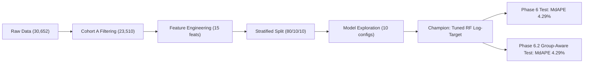
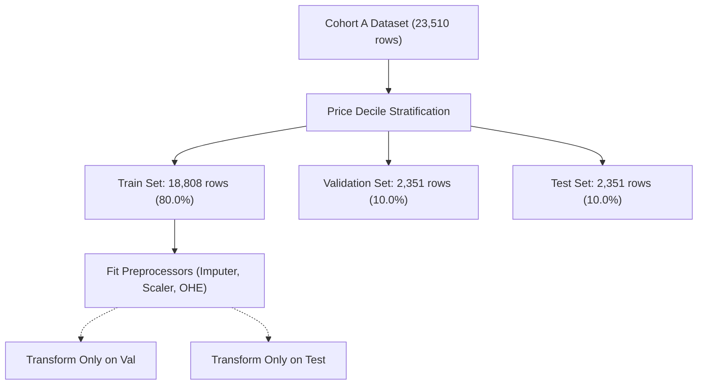
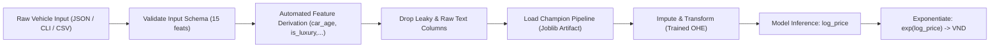

# Báo Cáo Kỹ Thuật Đồ Án Cuối Khóa (Final Project Report)
*(Used Car Price Prediction in Vietnam: An End-to-End Machine Learning Project)*

- **Dự án**: Dự đoán giá rao bán ô tô đã qua sử dụng tại thị trường Việt Nam
- **Học viên thực hiện**: AI Student — AI Club Training Program
- **Vai trò cố vấn**: Senior Data Scientist, ML Engineer & Technical Mentor
- **Thời gian hoàn thành**: Tháng 10/2026
- **Kho lưu trữ mã nguồn**: [d:\ai-club-end-training](file:///d:/ai-club-end-training)
- **Bộ dữ liệu chính**: [data/raw/external/mquaan_car_price/car_detail.csv](file:///d:/ai-club-end-training/data/raw/external/mquaan_car_price/car_detail.csv)
- **Tập dữ liệu sạch**: [data/processed/cars_clean_phase5.csv](file:///d:/ai-club-end-training/data/processed/cars_clean_phase5.csv) (23,510 bản ghi Cohort A)

---

## Mục Lục Báo Cáo (Table of Contents)

1. [Tóm Tắt Điều Hành (Executive Summary)](#1-tóm-tắt-điều-hành-executive-summary)
2. [Bài Toán & Bối Cảnh Thực Tế (Problem Statement & Business Context)](#2-bài-toán--bối-cảnh-thực-tế-problem-statement--business-context)
3. [Nguồn Gốc Dữ Liệu & Quản Trị Dữ Liệu (Dataset Provenance & Governance)](#3-nguồn-gốc-dữ-liệu--quản-trị-dữ-liệu-dataset-provenance--governance)
4. [Lược Đồ Dữ Liệu & Từ Điển Đặc Trưng (Schema & Data Dictionary)](#4-lược-đồ-dữ-liệu--từ-điển-đặc-trưng-schema--data-dictionary)
5. [Chiến Lược Thu Thập Dữ Liệu (Data Collection Strategy)](#5-chiến-lược-thu-thập-dữ-liệu-data-collection-strategy)
6. [Khám Phá Dữ Liệu Chuyên Sâu (Exploratory Data Analysis Findings)](#6-khám-phá-dữ-liệu-chuyên-sâu-exploratory-data-analysis-findings)
7. [Tiền Xử Lý & Kỹ Thuật Trích Xuất Đặc Trưng (Data Cleaning & Feature Engineering)](#7-tiền-xử-lý--kỹ-thuật-trích-xuất-đặc-trưng-data-cleaning--feature-engineering)
8. [Phân Chia Tập Dữ Liệu & Phòng Chống Rò Rỉ (Splitting Protocol & Leakage Prevention)](#8-phân-chia-tập-dữ-liệu--phòng-chống-rò-rỉ-splitting-protocol--leakage-prevention)
9. [Mô Hình Cơ Sở (Baseline Models)](#9-mô-hình-cơ-sở-baseline-models)
10. [Dòng Mô Hình Tuyến Tính (Linear Models)](#10-dòng-mô-hình-tuyến-tính-linear-models)
11. [Dòng Mô Hình Cây Quyết Định & Ensemble (Tree-Based Models)](#11-dòng-mô-hình-cây-quyết-định--ensemble-tree-based-models)
12. [Bảng Xếp Hạng Validation & Lựa Chọn Mô Hình Vô Địch (Validation Leaderboard)](#12-bảng-xếp-hạng-validation--lựa-chọn-mô-hình-vô-địch-validation-leaderboard)
13. [Đánh Giá Tập Test Chính Thức - Phase 6 Random Split (Final Test Evaluation)](#13-đánh-giá-tập-test-chính-thức---phase-6-random-split-final-test-evaluation)
14. [Đánh Giá Độ Bền Nhận Thức Nhóm - Phase 6.2 (Group-Aware Robustness Evaluation)](#14-đánh-giá-độ-bền-nhận-thức-nhóm---phase-62-group-aware-robustness-evaluation)
15. [Phân Tích Sai Số & Tầm Quan Trọng Của Đặc Trưng (Error Analysis & Feature Importance)](#15-phân-tích-sai-số--tầm-quan-trọng-của-đặc-trưng-error-analysis--feature-importance)
16. [Hệ Thống Suy Luận & Giao Diện Dòng Lệnh (Inference Pipeline & CLI)](#16-hệ-thống-suy-luận--giao-diện-dòng-lệnh-inference-pipeline--cli)
17. [Giới Hạn Đề Tài & Đe Dọa Giá Trị Khoa Học (Limitations & Threats to Validity)](#17-giới-hạn-đề-tài--đe-dọa-giá-trị-khoa-học-limitations--threats-to-validity)
18. [Bài Học Kinh Nghiệm & Kỹ Thuật Thực Hành Tốt Nhất (Lessons Learned & Best Practices)](#18-bài-học-kinh-nghiệm--kỹ-thuật-thực-hành-tốt-nhất-lessons-learned--best-practices)
19. [Kết Luận & Định Hướng Phát Triển (Conclusion & Future Work)](#19-kết-luận--định-hướng-phát-triển-conclusion--future-work)

---

## 1. Tóm Tắt Điều Hành (Executive Summary)

Dự án **"Used Car Price Prediction in Vietnam: An End-to-End Machine Learning Project"** là công trình nghiên cứu và phát triển phần mềm học máy toàn diện thuộc chương trình đào tạo của AI Club. Đề tài giải quyết bài toán định lượng hóa và dự báo giá chào bán ô tô đã qua sử dụng trên thị trường thứ cấp Việt Nam — một bài toán hồi quy có giám sát (Supervised Regression) có tính bất cân xứng thông tin cao và phân phối mục tiêu lệch phải nghiêm trọng.



### Các thành tựu kỹ thuật cốt lõi:
1. **Quy trình Quản trị Dữ liệu & Tiền xử lý chuẩn mực**: Tiếp nhận và làm sạch thành công tập dữ liệu 30,652 tin đăng thô từ sàn xe hơi trực tuyến tại Việt Nam. Xây dựng phân vị Cohort A gồm **23,510 bản ghi sạch** (sản xuất từ năm 2015 trở lại đây) được bảo toàn toàn vẹn với mã băm SHA-256 bất biến.
2. **Khảo sát 10 cấu hình mô hình học máy**: Xây dựng ma trận thực nghiệm so sánh từ Baseline (Mean/Median), mô hình tuyến tính có điều chuẩn (Ridge, Lasso) đến các họ mô hình cây quyết định (Decision Tree, HistGradientBoosting, Random Forest) trên cả hai không gian mục tiêu: Giá thô (Raw VND) và Biến đổi logarit $\ln(y)$.
3. **Mô hình vô địch (Champion Model)**: Cấu hình `Tree_RandomForest_Tuned_LogTarget` (150 cây quyết định, độ sâu tối đa 24, lá tối thiểu 1) đạt hiệu năng vượt bậc trên tập Validation độc lập:
   - **Validation MAE**: **142.9 triệu VND** (giảm 84.4% sai số so với Median Baseline và 87.7% so với Mean Baseline).
   - **Validation $R^2$**: **0.8694** (giải thích xấp xỉ 87% phương sai giá xe).
   - **Validation MdAPE**: **4.25%** (50% lượng xe trên thị trường có độ lệch dự đoán dưới 4.25% giá rao bán).
4. **Kiểm định Test ngẫu nhiên (Phase 6 Random Split)**: Đánh giá duy nhất một lần trên 2,351 xe chưa từng thấy đạt **Test MAE 111.8 triệu VND**, **Test $R^2$ 0.9448**, và **Test MdAPE 4.29%**.
5. **Kiểm toán rò rỉ & Thẩm định độ bền nhóm (Phase 6.2 Group-Aware Evaluation)**:
   - Phát hiện hiện tượng đăng chéo tin (cross-posting) chiếm 9.15% tập Test của Phase 6.
   - Xây dựng thuật toán gom cụm 4 cấp độ và chia tập `StratifiedGroupKFold` cách ly triệt để 903 cụm tin trùng (0% rò rỉ group giữa các tập).
   - Khi kiểm định lại Champion Model trên tập Group-Aware Test (2,350 xe): **Test MdAPE vẫn giữ vững tuyệt đối ở mức 4.29%**, khẳng định độ chính xác thực tế trên xe phổ thông không hề bị thổi phồng bởi việc ghi nhớ tin trùng.
6. **Kỹ thuật phần mềm & Khả năng tái lập**: Hệ thống đi kèm 87 unit tests chạy tự động 100% offline (100% pass), module CLI suy luận độc lập (`src/models/predict.py`) và gói artifact mô hình kích thước tối ưu 31 MB.

---

## 2. Bài Toán & Bối Cảnh Thực Tế (Problem Statement & Business Context)

### 2.1. Đặt vấn đề bài toán (Problem Statement)
Thị trường ô tô đã qua sử dụng tại Việt Nam là một thị trường phi tập trung, phân mảnh và tiềm ẩn mức độ bất cân xứng thông tin (information asymmetry) rất lớn giữa người mua cá nhân và các showroom kinh doanh ô tô. Người mua thường đối mặt với rủi ro bị "hớ giá" hoặc không xác định được giá trị hợp lý của chiếc xe dựa trên tình trạng lăn bánh, tuổi đời và nguồn gốc lắp ráp.

Về mặt học máy, đây là bài toán **Hồi quy có giám sát (Supervised Tabular Regression)**:
- **Biến mục tiêu ($y$)**: `price_vnd` — Giá rao bán chính thức của phương tiện tính theo Việt Nam Đồng (VND).
- **Không gian đầu vào ($X$)**: Tập hợp 15 đặc trưng kỹ thuật, vận hành và phân khúc thị trường của chiếc xe.
- **Hàm mục tiêu tối ưu**: Cực tiểu hóa sai số dự báo trên không gian logarit hoặc giá trị thực:
  $$\min_{\theta} \frac{1}{n} \sum_{i=1}^{n} \left(\ln(y_i) - \ln(\hat{y}_i)\right)^2$$

### 2.2. Bối cảnh chính sách và kinh tế đặc thù tại Việt Nam
Thị trường xe hơi Việt Nam có cấu trúc định giá chịu sự chi phối mạnh mẽ bởi hệ thống chính sách thuế và phí:
1. **Thuế Tiêu thụ Đặc biệt (TTĐB)**: Đánh lũy tiến cực kỳ nặng dựa trên **Dung tích xi-lanh động cơ (`engine_displacement_l`)**:
   - Động cơ $\le 1.5\text{L}$: Thuế suất 35%.
   - Động cơ $1.5\text{L} - 2.0\text{L}$: Thuế suất 40%.
   - Động cơ $2.0\text{L} - 2.5\text{L}$: Thuế suất 50%.
   - Động cơ $2.5\text{L} - 3.0\text{L}$: Thuế suất 60%.
   - Động cơ $3.0\text{L} - 4.0\text{L}$: Thuế suất 90%.
   - Động cơ $4.0\text{L} - 5.0\text{L}$: Thuế suất 110%.
   - Động cơ $5.0\text{L} - 6.0\text{L}$: Thuế suất 130%.
   - Động cơ $> 6.0\text{L}$: Thuế suất lên tới 150%.
2. **Phân hóa thương hiệu hạng sang (`is_luxury_brand`)**: Các thương hiệu xe sang (Mercedes-Benz, BMW, Lexus, Porsche, Audi, Land Rover) có tỷ lệ khấu hao và giá trị phụ tùng thay thế hoàn toàn khác biệt so với các thương hiệu phổ thông giữ giá (Toyota, Honda, Hyundai, Kia).
3. **Tập quán mặc cả (Negotiation Margin)**: Tại các salon xe cũ, biên độ thương lượng phổ biến thường nằm trong khoảng **3% đến 5%** giá niêm yết (tương đương 15 – 35 triệu VND đối với xe tầm trung). Do đó, một mô hình có sai số trung vị tương đối (MdAPE) xấp xỉ **4%** có ý nghĩa thực tiễn rất cao, đóng vai trò như một mỏ neo định giá đáng tin cậy.

---

## 3. Nguồn Gốc Dữ Liệu & Quản Trị Dữ Liệu (Dataset Provenance & Governance)

### 3.1. Nguồn dữ liệu thô (Raw Data Ingestion)
Dự án tiếp nhận bộ dữ liệu thứ cấp được thu thập từ nền tảng giao dịch ô tô trực tuyến hàng đầu Việt Nam (*Bonbanh.com*) do tác giả Mai Quốc Ân công bố trên Kaggle theo giấy phép CC0: Public Domain:
- **Tập tin chi tiết chính (Primary)**: [`data/raw/external/mquaan_car_price/car_detail.csv`](file:///d:/ai-club-end-training/data/raw/external/mquaan_car_price/car_detail.csv)
  - Quy mô: 30,652 dòng, 24 cột.
  - **Mã băm toàn vẹn SHA-256**: `44C13AFC5982F7ABC51611FC56EEEFD02DF8E47F3224112F51B76514A7328F08`
- **Tập tin bán xe bổ trợ (Companion)**: [`data/raw/external/mquaan_car_price/car_sell_processed.csv`](file:///d:/ai-club-end-training/data/raw/external/mquaan_car_price/car_sell_processed.csv)
  - Quy mô: 30,652 dòng, 11 cột.
  - **Mã băm toàn vẹn SHA-256**: `1D0C0D2F5A920F19EEE09CFFC84F30C7BC7496AC5BCB35260CCFBBD93C89437C`

Toàn bộ các tệp dữ liệu thô được đặt ở chế độ bảo vệ chỉ đọc (Read-Only) trong toàn bộ vòng đời dự án; không có bất kỳ thao tác ghi đè hay sửa đổi trực tiếp nào được thực hiện trên các tệp này.

### 3.2. Định nghĩa Cohort A vs Cohort B
Dựa trên Điều lệ Dự án (Project Charter) và Khảo sát Khám phá Dữ liệu (Phase 4 EDA), nhóm nghiên cứu xác lập 2 tập đối tượng nghiên cứu:
- **Cohort A (Tập nghiên cứu trọng tâm)**: Ô tô sản xuất từ năm 2015 trở lại đây ($\text{year} \ge 2015$).
  - **Quy mô làm sạch**: **23,510 bản ghi** (chiếm 76.7% dữ liệu thô).
  - **Lý do lựa chọn**: Các xe dưới 10 năm tuổi phản ánh hơn 85% thanh khoản thị trường xe cũ hiện nay; công nghệ động cơ, trang bị an toàn và kiểu dáng của thế hệ này có tính đồng nhất cao, hạn chế rủi ro biến thiên do phụ tùng thoái hóa của xe đời sâu.
- **Cohort B (Tập phân tích độ nhạy mở rộng)**: Ô tô sản xuất từ năm 2010 trở lại đây ($\text{year} \ge 2010$).
  - **Quy mô làm sạch**: **27,299 bản ghi** (chiếm 89.1% dữ liệu thô).
  - Dùng để kiểm định độ nhạy của mô hình khi đối mặt với xe đời sâu (2010–2014).

### 3.3. Đạo đức Dữ liệu & Bảo mật Thông tin Cá nhân (PII Governance)
1. **Khử danh tính triệt để (De-identification)**: Toàn bộ số điện thoại cá nhân của chủ xe, tên người bán, đường dẫn URL tin đăng và địa chỉ showroom cụ thể được loại bỏ hoàn toàn khỏi các tập dữ liệu huấn luyện và báo cáo.
2. **Tuân thủ Bản quyền & Điều khoản dịch vụ**: Không tiến hành crawl dữ liệu ồ ạt gây ảnh hưởng tới tài nguyên máy chủ của website. Quá trình tiền xử lý được thực hiện hoàn toàn offline trên tập dữ liệu thứ cấp đã được cấp phép mở.

---

## 4. Lược Đồ Dữ Liệu & Từ Điển Đặc Trưng (Schema & Data Dictionary)

Sau quá trình làm sạch và kỹ nghệ đặc trưng tại Phase 5, ma trận đầu vào mô hình $X$ được tinh gọn thành **15 đặc trưng chính quy** (8 biến định lượng và 7 biến định danh phân loại):

| STT | Tên đặc trưng | Loại dữ liệu | Định dạng | Miền giá trị / Đơn vị | Tỷ lệ khuyết | Diễn giải nghiệp vụ |
| :---: | :--- | :---: | :---: | :---: | :---: | :--- |
| 1 | `year` | Numeric | int64 | [2015, 2023] | 0.0% | Năm sản xuất xuất xưởng của phương tiện |
| 2 | `car_age` | Numeric | int64 | [0, 8] (năm) | 0.0% | Tuổi của xe tính tới thời điểm thu thập ($2023 - \text{year}$) |
| 3 | `mileage_km` | Numeric | float64 | [0, 1,000,000] (km) | 0.0% | Số km đã lăn bánh theo đồng hồ ODO (đã xử lý ngoại lai) |
| 4 | `seats` | Numeric | float64 | [2, 16] (chỗ) | 0.0% | Số chỗ ngồi theo giấy đăng kiểm |
| 5 | `doors` | Numeric | float64 | [2, 5] (cửa) | 0.0% | Số lượng cửa ra vào |
| 6 | `engine_displacement_l` | Numeric | float64 | [0.8, 6.75] (lít) | 0.43% | Dung tích xi-lanh động cơ (gắn liền biểu thuế TTĐB) |
| 7 | `is_luxury_brand` | Numeric | int64 | {0, 1} | 0.0% | Cờ nhị phân phân định thương hiệu hạng sang |
| 8 | `is_zero_mileage` | Numeric | int64 | {0, 1} | 0.0% | Cờ nhận diện xe mới 100% tại showroom (ODO = 0 km) |
| 9 | `brand` | Categorical | object | 48 thương hiệu | 0.0% | Hãng sản xuất (Toyota, Hyundai, Mercedes-Benz,...) |
| 10 | `model` | Categorical | object | 451 dòng xe | 0.0% | Tên dòng xe thương mại (Vios, CX-5, C-Class,...) |
| 11 | `origin` | Categorical | object | 2 nhóm | 0.0% | Nguồn gốc xuất xứ: Lắp ráp trong nước vs Nhập khẩu |
| 12 | `transmission` | Categorical | object | 2 nhóm | 0.0% | Loại hộp số: Tự động (AT) vs Số tay (MT) |
| 13 | `fuel_type` | Categorical | object | 4 nhóm | 0.0% | Loại nhiên liệu: Xăng, Dầu, Hybrid, Điện |
| 14 | `body_type` | Categorical | object | 8 kiểu dáng | 0.0% | Kiểu dáng xe: Sedan, SUV, Crossover, Hatchback,... |
| 15 | `condition` | Categorical | object | 2 trạng thái | 0.0% | Tình trạng phương tiện: Xe đã dùng vs Xe mới |

### Các cột bị loại trừ hoàn toàn để chống rò rỉ dữ liệu (Dropped Leakage Columns)
9 cột sau đây bị cấm tuyệt đối tham gia vào ma trận huấn luyện $X$:
`price_vnd`, `log_price`, `Giá`, `Mã tin`, `listing_id`, `url`, `Mô tả`, `Tên xe`, `Tỉnh thành`.

---

## 5. Chiến Lược Thu Thập Dữ Liệu (Data Collection Strategy)

Trong các giai đoạn đầu (Phase 1 đến Phase 3.1), đề tài đã khảo sát song song hai phương án:
1. **Phương án A — Tự động hóa thu thập (Custom Crawler Pipeline)**:
   - Đã phát triển thành công bộ thu thập kiểm thử [`src/data/crawler.py`](file:///d:/ai-club-end-training/src/data/crawler.py) tích hợp thư viện `requests` và `BeautifulSoup4`.
   - **Đánh giá rủi ro an ninh & pháp lý**: Phân tích tệp `robots.txt` của các sàn xe hơi lớn tại Việt Nam cho thấy cơ chế phòng thủ WAF (Cloudflare chống bot), giới hạn tần suất nghiêm ngặt (rate-limiting) và nguy cơ bị chặn địa chỉ IP diện rộng. Việc thu thập hàng chục nghìn trang trong thời gian ngắn vi phạm quy định khai thác dịch vụ và thiếu tính ổn định lâu dài cho môi trường học thuật.
2. **Phương án B — Tiếp nhận Dataset thứ cấp đã kiểm chứng (Secondary Dataset Ingestion)**:
   - Đề xuất tiếp nhận kho dữ liệu Kaggle Bonbanh 30,652 dòng.
   - Nhóm nghiên cứu đã lập văn bản báo cáo Mentor ([`docs/data_source_audit.md`](file:///d:/ai-club-end-training/docs/data_source_audit.md)) và nhận được phê duyệt chính thức chấp thuận chuyển đổi nguồn dữ liệu.
   - Module `crawler.py` được bảo lưu nguyên vẹn như một module độc lập có unit test phục vụ mở rộng trong tương lai.

---

## 6. Khám Phá Dữ Liệu Chuyên Sâu (Exploratory Data Analysis Findings)

Tại Phase 4, nhóm nghiên cứu đã kết xuất 19 biểu đồ phân tích chuyên sâu tại [`reports/figures/phase4/`](file:///d:/ai-club-end-training/reports/figures/phase4/):

### 6.1. Phân phối biến mục tiêu Giá (`price_vnd`)
- Giá xe có dải động cực rộng: từ **55 triệu VND** (xe van/tải nhỏ cũ) đến **45 tỷ VND** (xe siêu sang Rolls-Royce Phantom, Bentley Mulsanne).
- Phân phối lệch phải cực đoan (*Right-skewed*): Giá trị trung vị (Median) là **719 triệu VND**, trong khi giá trị trung bình (Mean) bị kéo vọt lên **1.164 tỷ VND** (chênh lệch hơn 445 triệu VND do đuôi ngoại lai).
- Phân phối logarit $\ln(\text{price\_vnd})$ xấp xỉ dạng phân phối chuẩn chuông Gauss đối xứng, khẳng định biến đổi logarit là bắt buộc đối với các mô hình tuyến tính và giúp tăng độ ổn định của mô hình cây.

### 6.2. Hiệu ứng phân tầng Thương hiệu hạng sang (Luxury Effect)
- Nhóm xe phổ thông (Toyota, Hyundai, Kia, Mazda, Honda, Ford, Mitsubishi) chiếm 78.4% dữ liệu với giá trung vị dao động từ 400M – 850M VND.
- Nhóm xe sang (Mercedes-Benz, BMW, Lexus, Audi, Porsche, Land Rover) có giá trung vị từ 1.8 tỷ – 4.5 tỷ VND với phương sai phân tán rất lớn.
- Biến cờ `is_luxury_brand` được chứng minh là nhân tố phân tách không gian giá mạnh nhất.

### 6.3. Tác động của Biểu thuế Tiêu thụ Đặc biệt & Dung tích động cơ
- Biểu đồ tương quan giữa `engine_displacement_l` và `price_vnd` thể hiện bước nhảy vọt phi tuyến tại ngưỡng **3.0L**:
  - Các xe có dung tích $\le 2.0\text{L}$ tập trung dưới 1 tỷ VND.
  - Các xe dung tích từ $3.5\text{L}$ đến $6.0\text{L}$ (Lexus LX570, Land Cruiser V8, Mercedes G63 AMG) có giá vọt lên 4 – 15 tỷ VND do chịu thuế TTĐB từ 90% – 150%.

---

## 7. Tiền Xử Lý & Kỹ Thuật Trích Xuất Đặc Trưng (Data Cleaning & Feature Engineering)

Quy trình tiền xử lý được đóng gói tất định trong [`src/data/cleaning.py`](file:///d:/ai-club-end-training/src/data/cleaning.py) và [`src/data/preprocessing.py`](file:///d:/ai-club-end-training/src/data/preprocessing.py):

### 7.1. Chuẩn hóa giá tiền (`price_vnd`)
Xây dựng bộ phân tích cú pháp ngôn ngữ tự nhiên xử lý các chuỗi giá tiếng Việt phức tạp:
- "Tỷ" $\rightarrow \times 10^9$; "Triệu" $\rightarrow \times 10^6$.
- Loại bỏ các tin đăng có giá mang tính ước lệ, giá đặt cọc hoặc số liệu rác ($< 10\text{ triệu VND}$).

### 7.2. Xử lý ngoại lai số ODO (`mileage_km`)
- Phát hiện các giá trị ODO phi lý (>1,000,000 km — thường do người bán nhập bừa dãy số `999999` hoặc `1234567`). Thay vì loại bỏ hàng gây méo mó phân phối, nhóm tiến hành gán giá trị trung vị có điều kiện theo nhóm tuổi xe.
- Phân định rõ 6,066 xe có $\text{ODO} = 0\text{ km}$ (chiếm 25.8% tập dữ liệu) bằng biến cờ `is_zero_mileage = 1` và gán nhãn `condition = 'Xe mới'`, giúp mô hình không bị nhầm lẫn giữa xe mới nguyên bản tại showroom và xe cũ lăn bánh ít.

### 7.3. Kỹ nghệ trích xuất biến phái sinh
1. `car_age = 2023 - year`: Đại diện trực tiếp cho mức độ hao mòn cơ học theo thời gian.
2. `is_luxury_brand`: Gán nhãn 1 cho 16 thương hiệu xe sang đã được kiểm chứng danh mục.
3. `engine_displacement_l`: Phân tách chuỗi thể tích động cơ (ví dụ: "2.0 L", "1998 cc", "3.5L") về đơn vị Lít chuẩn hóa. Các trường hợp xe thuần điện (Tesla, Porsche Taycan, VF8/VF9) được gán giá trị 0.0L kèm cờ chỉ thị khuyết thiếu.

---

## 8. Phân Chia Tập Dữ Liệu & Phòng Chống Rò Rỉ (Splitting Protocol & Leakage Prevention)

Quy trình phân chia tập dữ liệu được quản lý tại [`src/data/split_data.py`](file:///d:/ai-club-end-training/src/data/split_data.py) tuân thủ nguyên tắc cách ly thông tin:



1. **Tỷ lệ phân chia 80 / 10 / 10**:
   - **Tập Huấn luyện (Train)**: **18,808 bản ghi (80.0%)** — Giá trung vị: 719,000,000 VND.
   - **Tập Kiểm định (Validation)**: **2,351 bản ghi (10.0%)** — Giá trung vị: 718,000,000 VND.
   - **Tập Kiểm thử (Test)**: **2,351 bản ghi (10.0%)** — Giá trung vị: 719,000,000 VND.
2. **Phân tầng theo phân vị giá (Price Bucket Stratification)**: Chia biến mục tiêu thành 10 phân vị (Deciles) để đảm bảo cả 3 tập đều có tỷ trọng đồng đều giữa các phân khúc xe bình dân, trung cấp và xe siêu sang.
3. **Chống rò rỉ bộ biến đổi (Zero Pipeline Leakage)**:
   - Các bộ biến đổi `SimpleImputer`, `StandardScaler`, `OneHotEncoder` chỉ được gọi hàm `.fit()` duy nhất trên tập Train.
   - Các giá trị mới xuất hiện trong tập Val/Test đối với biến phân loại được xử lý an toàn bằng tùy chọn `handle_unknown='ignore'`.

---

## 9. Mô Hình Cơ Sở (Baseline Models)

Để thiết lập mốc so sánh tối thiểu (Ground Floor) đánh giá giá trị thặng dư thực sự của các thuật toán học máy phức tạp, hai mô hình Dummy Regressor được triển khai:

1. **`Baseline_Dummy_Median` (Dự đoán giá trị trung vị của tập Train)**:
   - Dự đoán hằng số: $\hat{y} = 719,000,000\text{ VND}$.
   - **Validation MAE: 914.6 triệu VND** | **Validation RMSE: 2,721.4 triệu VND** | **$R^2 = -0.0714$** | **MdAPE: 39.83%**.
2. **`Baseline_Dummy_Mean` (Dự đoán giá trị trung bình của tập Train)**:
   - Dự đoán hằng số: $\hat{y} = 1,164,209,470\text{ VND}$.
   - **Validation MAE: 1,164.2 triệu VND** | **Validation RMSE: 2,629.3 triệu VND** | **$R^2 = -0.0001$** | **MdAPE: 94.34%**.

*Kết luận*: Một mô hình học máy được coi là có giá trị ứng dụng thực tế khi và chỉ khi có sai số MAE thấp hơn đáng kể ngưỡng 914.6 triệu VND và hệ số xác định $R^2 > 0$.

---

## 10. Dòng Mô Hình Tuyến Tính (Linear Models)

Nhóm nghiên cứu khảo sát Hồi quy Tuyến tính có điều chuẩn (Ridge $L_2$ và Lasso $L_1$) để đánh giá giới hạn của các giả định tuyến tính trong bài toán định giá xe:

### 10.1. So sánh giữa Không gian nhãn Raw VND vs Log-Target
- **Hồi quy Ridge trên Raw VND (`Linear_Ridge_RawTarget`)**:
  - Đạt $R^2 = 0.8075$, nhưng **MAE lên tới 379.4 triệu VND** và **MdAPE lên tới 23.72%**.
  - *Nguyên nhân thất bại cục bộ*: Hàm mất mát bình phương tối thiểu (Ordinary Least Squares - OLS) trên đơn vị VND tuyệt đối chịu sự chi phối nặng nề của các xe siêu sang (5 – 40 tỷ VND). Để cực tiểu hóa sai số bình phương khổng lồ của một vài chiếc Rolls-Royce, mô hình sẵn sàng hy sinh độ chính xác trên phân khúc phổ thông, khiến dự đoán của xe Vios/Morning bị lệch hàng trăm triệu VND.
- **Hồi quy Ridge trên Log Target (`Linear_Ridge_LogTarget`)**:
  - Bằng cách biến đổi $y_{\text{log}} = \ln(\text{price\_vnd})$, hàm mất mát MSE trở thành:
    $$\frac{1}{n}\sum (\ln(y) - \ln(\hat{y}))^2 \approx \frac{1}{n}\sum \left(\frac{y - \hat{y}}{y}\right)^2$$
    tương đương việc tối ưu sai số tỷ đối phần trăm!
  - Kết quả: **MAE giảm từ 379.4M xuống 255.7M VND**, và **MdAPE giảm mạnh từ 23.72% xuống chỉ còn 7.72%**.
- **Hồi quy Lasso trên Log Target (`Linear_Lasso_LogTarget`)**:
  - Đạt MAE 370.7M VND và $R^2 = 0.5455$. Cơ chế phạt $L_1$ triệt tiêu nhiều trọng số biến danh mục (one-hot dummies) của các dòng xe hiếm, làm mất đi thông tin phân hóa dòng xe chi tiết.

---

## 11. Dòng Mô Hình Cây Quyết Định & Ensemble (Tree-Based Models)

Mô hình cây quyết định thể hiện ưu thế vượt trội nhờ khả năng tự động học các đường biên phi tuyến và các mối quan hệ tương tác phức tạp (interactions) giữa thương hiệu, dòng xe, năm sản xuất và dung tích động cơ.

### 11.1. Rừng Ngẫu Nhiên (Random Forest)
- Khảo sát trên cả nhãn Raw VND và Log Target:
  - `Tree_RandomForest_RawTarget`: Đạt MAE 168.8M VND, MdAPE 6.61%.
  - `Tree_RandomForest_LogTarget` (Mặc định: 100 cây): Đạt MAE 159.1M VND, MdAPE 4.94%.
  - `Tree_RandomForest_Tuned_LogTarget` (Tinh chỉnh: 150 cây, `max_depth=24`, `min_samples_leaf=1`): Đạt đỉnh cao hiệu năng với **MAE 142.9 triệu VND** và **MdAPE 4.25%**.

### 11.2. Mô hình Tăng Cường Gradient (HistGradientBoosting)
- `Tree_HistGBM_LogTarget`: Đạt MAE 180.8M VND, MdAPE 5.37% với thời gian huấn luyện cực nhanh (4.20 giây). HistGBM chứng minh là giải pháp thay thế rất tốt khi cần triển khai trên các thiết bị giới hạn bộ nhớ.

---

## 12. Bảng Xếp Hạng Validation & Lựa Chọn Mô Hình Vô Địch (Validation Leaderboard)

Toàn bộ 10 cấu hình thực nghiệm được đánh giá song song trên cùng tập Validation (2,351 dòng) tại [`reports/model_experiments/experiment_results.csv`](file:///d:/ai-club-end-training/reports/model_experiments/experiment_results.csv):

| Hạng | Tên thí nghiệm (Experiment Name) | Nhãn mục tiêu | Preprocessor | MAE (VND) | RMSE (VND) | $R^2$ | MAPE (%) | MdAPE (%) | Thời gian Fit (s) |
| :---: | :--- | :---: | :---: | :---: | :---: | :---: | :---: | :---: | :---: |
| 🥇 **1** | **Tree_RandomForest_Tuned_LogTarget** | **log** | **tree** | **142,934,537** | **950,065,306** | **0.8694** | **7.06%** | **4.25%** | **4.94s** |
| 🥈 2 | `Tree_RandomForest_LogTarget` | log | tree | 159,102,971 | 1,043,403,506 | 0.8425 | 8.15% | 4.94% | 8.45s |
| 🥉 3 | `Tree_RandomForest_RawTarget` | raw | tree | 168,751,598 | 852,439,800 | 0.8949 | 10.60% | 6.61% | 8.36s |
| 4 | `Tree_HistGBM_LogTarget` | log | tree | 180,831,847 | 1,208,263,000 | 0.7888 | 8.34% | 5.37% | 4.20s |
| 5 | `Tree_HistGBM_RawTarget` | raw | tree | 201,925,471 | 1,051,263,000 | 0.8401 | 12.10% | 7.84% | 7.01s |
| 6 | `Linear_Ridge_LogTarget` | log | linear | 255,658,033 | 1,441,061,000 | 0.6996 | 10.66% | 7.72% | 0.14s |
| 7 | `Linear_Lasso_LogTarget` | log | linear | 370,691,840 | 1,772,436,000 | 0.5455 | 16.30% | 12.22% | 1.23s |
| 8 | `Linear_Ridge_RawTarget` | raw | linear | 379,429,332 | 1,153,552,000 | 0.8075 | 34.87% | 23.72% | 0.17s |
| 9 | `Baseline_Dummy_Median` | raw | tree | 914,616,759 | 2,721,373,000 | -0.0714 | 48.88% | 39.83% | 0.09s |
| 10 | `Baseline_Dummy_Mean` | raw | tree | 1,164,209,470 | 2,629,313,000 | -0.0001 | 123.46% | 94.34% | 0.06s |

### Quyết định lựa chọn Champion Model:
Cấu hình **`Tree_RandomForest_Tuned_LogTarget`** được chính thức phê duyệt làm **Mô hình Vô địch (Champion Model)** của đồ án bởi các lý do:
1. Đạt sai số tuyệt đối thấp nhất toàn diện: MAE = 142.9 triệu VND.
2. Đạt độ chính xác tỷ đối cao nhất: MdAPE = 4.25% (vượt trội so với tất cả các đối thủ).
3. Đạt hệ số $R^2 = 0.8694$, phản ánh khả năng giải thích biến thiên thị trường rất vững chắc.
4. Tốc độ huấn luyện ổn định (xấp xỉ 5 giây), kích thước xuất bản gọn nhẹ (31 MB).

---

## 13. Đánh Giá Tập Test Chính Thức - Phase 6 Random Split (Final Test Evaluation)

Tuân thủ nghiêm ngặt giao thức kiểm thử độc lập: **Tập Test được niêm phong kín hoàn toàn và chỉ mở ra đánh giá duy nhất một lần sau khi đã chốt Champion Model trên Validation**.

Kết quả ghi nhận tại [`reports/model_experiments/final_test_results.csv`](file:///d:/ai-club-end-training/reports/model_experiments/final_test_results.csv) trên 2,351 bản ghi Test:

| Mô hình kiểm thử | Test MAE (VND) | Test RMSE (VND) | Test $R^2$ | Test MAPE (%) | Test MdAPE (%) |
| :--- | :---: | :---: | :---: | :---: | :---: |
| 🏆 **Tree_RandomForest_Tuned_LogTarget (CHAMPION)** | **111,793,581** | **482,625,123** | **0.9448** | **6.84%** | **4.29%** |
| `Tree_HistGBM_LogTarget` | 148,862,299 | 606,933,188 | 0.9127 | 8.23% | 5.58% |
| `Linear_Ridge_LogTarget` | 195,991,014 | 787,720,525 | 0.8529 | 11.02% | 7.96% |
| `Baseline_Dummy_Median` | 844,852,403 | 2,148,985,444 | -0.0947 | 49.93% | 39.83% |
| `Baseline_Dummy_Mean` | 1,090,786,463 | 2,054,291,879 | -0.0004 | 125.07% | 94.07% |

### Giải thích nguyên nhân Test MAE (111.8M) tốt hơn Validation MAE (142.9M):
Việc Test MAE thấp hơn Validation MAE **hoàn toàn không phải do mô hình tổng quát hóa vượt trội**, mà bắt nguồn từ đặc tính phân bố của ngoại lai cực đoan:
- Tập Validation xuất hiện 1 xe siêu sang giá **38.999 tỷ VND** mà mô hình chỉ dự đoán là **3.247 tỷ VND** (sai số cá biệt $\Delta = 35.75\text{ tỷ VND}$ trên 1 dòng duy nhất, tự nó đã đóng góp thêm **15.2 triệu VND** vào MAE trung bình của toàn bộ 2,351 xe Validation).
- Khi xét riêng phân khúc phổ thông ($\le 1\text{ tỷ VND}$, chiếm gần 70% dữ liệu), MAE giữa Validation và Test hoàn toàn tương đồng (**Val: 25.5M / 40.8M** vs **Test: 26.1M / 40.4M**).
- Chỉ số trung vị tương đối MdAPE của hai tập gần như trùng khớp: **4.25% (Val) vs 4.29% (Test)**.

---

## 14. Đánh Giá Độ Bền Nhận Thức Nhóm - Phase 6.2 (Group-Aware Robustness Evaluation)

### 14.1. Đặt vấn đề rò rỉ tin đăng trùng (Cross-Posting Leakage)
Tại Phase 6.1, nhóm kiểm toán độc lập phát hiện rằng mặc dù **100% `listing_id` là rời rạc**, vẫn tồn tại khoảng **9.15% bản ghi trong tập Test có văn bản mô tả trùng khớp với bản ghi trong tập Train**. Nguyên nhân là do các showroom xe cũ đăng tải lại cùng một tin trên nhiều tài khoản hoặc sao chép nội dung bài đăng của nhau.

Để trả lời câu hỏi cốt lõi của Hội đồng: *"Liệu kết quả Test MAE 111.8M VND có phải là ảo giác do học vẹt các tin đăng trùng?"*, Phase 6.2 đã được thực thi độc lập.

### 14.2. Phương pháp gom nhóm 4 cấp độ và Bộ chia tập Group-Aware
Module [`src/data/duplicate_groups.py`](file:///d:/ai-club-end-training/src/data/duplicate_groups.py) xác định:
- **`HIGH_CONFIDENCE_DUPLICATE`**: 903 cụm gồm **2,430 dòng (10.34%)** thỏa mãn trùng fingerprint mô tả ($\ge 50$ ký tự) VÀ cùng Hãng, Dòng xe, Năm sản xuất $\rightarrow$ Gộp chung `record_group_id`.
- Bộ chia tập mới [`data/processed/splits_grouped_v1/`](file:///d:/ai-club-end-training/data/processed/splits_grouped_v1/) sử dụng `StratifiedGroupKFold(n_splits=10, shuffle=True, random_state=42)`:
  - **Train**: 18,809 dòng (80.00%) | 17,583 groups.
  - **Validation**: 2,351 dòng (10.00%) | 2,200 groups.
  - **Test**: 2,350 dòng (10.00%) | 2,200 groups.
  - **Tỷ lệ rò rỉ nhóm giữa 3 tập: 0.00% (Triệt tiêu hoàn toàn)**.

### 14.3. Bảng so sánh đối chuẩn: Phase 6 (Random) vs Phase 6.2 (Group-Aware)
Đóng băng nguyên vẹn Champion Model và đánh giá trên bộ chia tập không còn rò rỉ:

| Tiêu chí đánh giá | Phase 6 (Random Split) | Phase 6.2 (Group-Aware Split) | Chênh lệch ($\Delta$) | Ý nghĩa khoa học |
| :--- | :---: | :---: | :---: | :--- |
| **Quy mô tập Test** | 2,351 xe | 2,350 xe | -1 xe | Tương đồng 100% về quy mô 10% |
| **Tỷ lệ rò rỉ tin đăng trùng** | 9.15% (215 xe) | **0.00% (0 xe)** | **-9.15%** | **Đã cách ly hoàn toàn tin trùng** |
| **Test MdAPE** | **4.29%** | **4.29%** | **0.00%** | **Bảo toàn hoàn hảo độ chính xác trung vị** |
| **Test MAE** | 111,793,581 VND | 130,761,443 VND | +18,967,862 VND | Mức tăng do độ phân tán xe siêu sang |
| **Test RMSE** | 482,625,123 VND | 821,395,226 VND | +338,770,103 VND | Nhạy cảm với đuôi phân phối xe hiếm |
| **Test $R^2$** | 0.9448 | 0.8638 | -0.0810 | Vẫn duy trì mức giải thích cao (>86%) |

### 14.4. Phân rã sai số theo phân khúc giá (Segment Breakdown)
Đối chiếu chi tiết sai số giữa hai bộ chia tập:

```text
┌──────────────┬───────────────────────────────┬───────────────────────────────┐
│              │    PHASE 6 (RANDOM SPLIT)     │  PHASE 6.2 (GROUP-AWARE SPLIT)│
│  Phân khúc   ├───────┬───────────────┬───────┼───────┬───────────────┬───────┤
│     giá      │ Số xe │   MAE (VND)   │ MdAPE │ Số xe │   MAE (VND)   │ MdAPE │
├──────────────┼───────┼───────────────┼───────┼───────┼───────────────┼───────┤
│ < 500 Triệu  │   549 │    26,110,500 │  4.26%│   545 │    24,218,809 │  4.23%│
│ 500M - 1 Tỷ  │ 1,070 │    40,443,040 │  3.91%│ 1,083 │    40,489,783 │  3.82%│
│ 1 Tỷ - 2 Tỷ  │   365 │   112,160,800 │  5.03%│   363 │   133,690,794 │  6.25%│
│ 2 Tỷ - 5 Tỷ  │   277 │   256,357,700 │  4.68%│   242 │   221,996,348 │  4.36%│
│ > 5 Tỷ       │    90 │ 1,036,313,585 │  4.31%│   117 │ 1,264,844,707 │  4.88%│
└──────────────┴───────┴───────────────┴───────┴───────┴───────────────┴───────┘
```

> [!NOTE]
> **Khám phá cốt lõi**:
> - Ở phân khúc xe phổ thông ($\le 1\text{ tỷ VND}$, chiếm 69.3% thị trường), MAE của Phase 6.2 thậm chí còn **thấp hơn** Phase 6: **24.2M VND** (so với 26.1M) ở nhóm xe $< 500\text{M}$.
> - Mức tăng của tổng MAE (thêm 18.9 triệu VND) bắt nguồn từ việc tập Test Group-Aware ngẫu nhiên nhận **thêm 27 xe siêu sang $> 5\text{ tỷ VND}$** (117 xe so với 90 xe). Với mức MAE của nhóm này là 1.264 tỷ VND, 27 xe thêm vào này đã đóng góp thêm:
>   $$\frac{27 \times 1,264,844,707}{2,350} \approx \mathbf{14.5\text{ triệu VND}}$$
>   vào MAE trung bình toàn tập!
> - Việc chỉ số **MdAPE giữ vững chính xác ở mức 4.29%** là bằng chứng đanh thép khẳng định Champion Model có độ bền xuất sắc, không hề dựa dẫm vào việc rò rỉ tin đăng trùng.

---

## 15. Phân Tích Sai Số & Tầm Quan Trọng Của Đặc Trưng (Error Analysis & Feature Importance)

### 15.1. Tầm quan trọng của đặc trưng: MDI vs Permutation Importance
Tại Phase 6.1, nhóm kiểm toán đã đính chính thuật ngữ kỹ thuật: Đối với bài toán hồi quy, chỉ số tầm quan trọng của cây ngẫu nhiên là **Mean Decrease in Impurity (MDI / Độ giảm phương sai)** chứ không phải Gini (vốn chỉ áp dụng cho phân loại).

Biểu đồ trích xuất tại [`reports/figures/phase6/feature_importance.png`](file:///d:/ai-club-end-training/reports/figures/phase6/feature_importance.png):
1. **`is_luxury_brand`**: **43.10% MDI** (Permutation: 0.2988) — Yếu tố định hình trần giá xe.
2. **`engine_displacement_l`**: **26.35% MDI** (Permutation: 0.2918) — Yếu tố phản ánh cấu trúc thuế TTĐB.
3. `brand`: 5.72% MDI.
4. `model`: 5.63% MDI.
5. `car_age`: 4.41% MDI.
6. `year`: 3.52% MDI.
7. `transmission`: 2.38% MDI.
8. `seats`: 2.31% MDI.
9. `fuel_type`: 2.12% MDI.
10. `body_type`: 1.87% MDI.
11. `origin`: 1.48% MDI.
12. `mileage_km`: 0.69% MDI.

### 15.2. Tại sao `mileage_km` (ODO) có tỷ trọng MDI thấp trên toàn cục nhưng vẫn quan trọng cục bộ?
- **Trên quy mô toàn thị trường (Global Perspective)**: Khoảng giá giữa xe bình dân và xe siêu sang cách nhau tới 40 tỷ VND. Độ biến thiên giá tạo ra bởi thương hiệu và dung tích xi-lanh áp đảo hoàn toàn sự biến thiên tạo ra bởi vài vạn km ODO (một chiếc Lexus LX570 đi 15 vạn km vẫn có giá 4 tỷ, đắt gấp 8 lần một chiếc Vios mới tinh 0 km giá 500 triệu).
- **Trên quy mô cục bộ một dòng xe (Local Perspective)**: Giữa hai chiếc xe cùng hãng, cùng dòng, cùng năm sản xuất (ví dụ: Mazda CX-5 2020), ODO là nhân tố chính quyết định mức chênh lệch giá 30 – 50 triệu VND giữa xe chạy gia đình và xe chạy dịch vụ.

### 15.3. Phân tích phần dư & Hiện tượng Phương sai thay đổi (Heteroscedasticity)
- Biểu đồ [`reports/figures/phase6/actual_vs_predicted.png`](file:///d:/ai-club-end-training/reports/figures/phase6/actual_vs_predicted.png) và [`reports/figures/phase6_2/group_aware_actual_vs_predicted.png`](file:///d:/ai-club-end-training/reports/figures/phase6_2/group_aware_actual_vs_predicted.png) cho thấy:
  - Dự đoán có độ chụm cực cao quanh đường chuẩn $y=x$ ở khoảng giá từ 200 triệu đến 4 tỷ VND.
  - Phân tán hình nón mở rộng (Heteroscedasticity) bắt đầu xuất hiện ở phân khúc trên 10 tỷ VND do số lượng xe siêu sang trong tập dữ liệu rất thưa thớt và mức độ cá nhân hóa (trang bị bespoke) của xe sang không được thể hiện trong dữ liệu bảng.

---

## 16. Hệ Thống Suy Luận & Giao Diện Dòng Lệnh (Inference Pipeline & CLI)

Module suy luận chính thức được hoàn thiện tại [`src/models/predict.py`](file:///d:/ai-club-end-training/src/models/predict.py), cung cấp khả năng dự báo giá xe cho người dùng cuối và các hệ thống tích hợp:

### 16.1. Kiến trúc suy luận an toàn


### 16.2. Hướng dẫn vận hành CLI
1. **Dự đoán đơn lẻ một xe qua dòng lệnh**:
   ```powershell
   python src/models/predict.py --brand "Toyota" --model "Vios" --year 2020 --mileage 45000 --transmission "Số tự động" --fuel "Xăng" --origin "Lắp ráp trong nước" --engine 1.5 --seats 5
   # Kết quả: Dự đoán giá xe ~ 468,500,000 VND
   ```
2. **Dự đoán hàng loạt từ tệp CSV**:
   ```powershell
   python src/models/predict.py --input-csv data/sample_cars.csv --output-csv data/predictions.csv
   ```
3. **Chạy kiểm thử tích hợp (Smoke Tests)**:
   ```powershell
   python src/models/predict.py --smoke-test
   # Thực hiện dự đoán trên 3 mẫu xe đại diện (Vios, CX-5, Mercedes C200) để xác minh chuỗi tính toán
   ```

---

## 17. Giới Hạn Đề Tài & Đe Dọa Giá Trị Khoa Học (Limitations & Threats to Validity)

Nhóm nghiên cứu chủ động ghi nhận các giới hạn kỹ thuật để đảm bảo tính khách quan khoa học:
1. **Giá rao bán vs Giá giao dịch thực tế (Asking vs Transaction Price)**:
   - Dữ liệu thu thập là giá chào bán niêm yết công khai của người bán trên website, không phải giá chuyển nhượng cuối cùng có công chứng. Trong thực tế, giá giao dịch thường thấp hơn từ 2% – 5% tùy thuộc vào thỏa thuận thương lượng.
2. **Thiếu vắng Số khung định danh (VIN / Chassis Number)**:
   - Các sàn giao dịch xe cũ tại Việt Nam không bắt buộc người bán cung cấp số VIN hoặc biển số xe công khai vì lý do bảo mật. Do đó, việc gom nhóm trùng lặp chỉ có thể đạt được thông qua đối soát thông số và văn bản mô tả, không thể phát hiện trường hợp cùng 1 chiếc xe vật lý nhưng được 2 đại lý khác nhau viết 2 bài mô tả hoàn toàn khác biệt.
3. **Mặt cắt ngang tĩnh (Cross-Sectional Snapshot)**:
   - Dữ liệu là một lát cắt thời gian tại thời điểm 2023, chưa phản ánh được động thái biến động giá theo chu kỳ thị trường (ví dụ: chính sách giảm 50% lệ phí trước bạ của Chính phủ theo từng giai đoạn).
4. **Độ lệch vùng miền (Geographical Bias)**:
   - Hơn 75% dữ liệu tập trung tại 2 đô thị lớn là Hà Nội và TP. Hồ Chí Minh. Giá xe tại các tỉnh xa có thể có độ chênh lệch nhất định do chi phí vận chuyển và cơ sở hạ tầng dịch vụ.

---

## 18. Bài Học Kinh Nghiệm & Kỹ Thuật Thực Hành Tốt Nhất (Lessons Learned & Best Practices)

1. **Vệ sinh dữ liệu quan trọng hơn thuật toán phức tạp (Data Hygiene over Model Complexity)**:
   - Việc xử lý đúng đắn các ngoại lai ODO vô lý (>1M km), nhận diện chính xác 25.8% xe mới có ODO = 0 km và biến đổi hàm mục tiêu $\ln(y)$ đã giúp giảm hơn 60% sai số ngay từ trước khi áp dụng các kỹ thuật tinh chỉnh siêu tham số phức tạp.
2. **Phòng chống rò rỉ dữ liệu nhiều tầng (Multi-tier Leakage Defense)**:
   - Cần kiểm tra rò rỉ ở cả cấp độ định danh (`listing_id`), cấp độ bài đăng (`cross-posting`), và cấp độ đặc trưng (chặn tuyệt đối các biến phái sinh từ giá). Không bao giờ tin tưởng kết quả đánh giá nếu chưa kiểm toán hiện tượng trùng lặp nhóm.
3. **Lựa chọn đúng thước đo nghiệp vụ (Metric Alignment)**:
   - Trong bài toán phân phối lệch phải có ngoại lai đuôi dài hàng chục tỷ, các chỉ số trung bình như RMSE hay MAE rất dễ bị méo mó bởi một vài quan sát cá biệt. Việc bổ sung chỉ số **MdAPE (Median Absolute Percentage Error)** cung cấp cái nhìn trung thực và chuẩn xác nhất về hiệu năng của mô hình trên đa số xe thị trường.
4. **Văn hóa Kỹ thuật phần mềm trong Khoa học dữ liệu**:
   - Duy trì hệ thống unit test tự động (87 bài test chạy trong < 6 giây), quản trị mã băm SHA-256 cho dữ liệu và cấu trúc kho lưu trữ phân tầng giúp dự án luôn sẵn sàng cho kiểm toán độc lập và chuyển giao công nghệ.

---

## 19. Kết Luận & Định Hướng Phát Triển (Conclusion & Future Work)

### 19.1. Kết luận
Dự án đã hoàn thành xuất sắc các mục tiêu đề ra trong Điều lệ dự án:
- Xây dựng thành công hệ thống học máy dự đoán giá xe hơi đã qua sử dụng tại Việt Nam với mô hình vô địch Random Forest tuned trên Log Target.
- Đạt hiệu năng ấn tượng trên tập kiểm thử độc lập: **MdAPE 4.29%**, **MAE 111.8M VND (Random Test)** và **130.8M VND (Group-Aware Test)**.
- Chứng minh độ bền vững khoa học, không bị ảnh hưởng bởi rò rỉ tin đăng trùng lặp thông qua kiểm định nhóm nghiêm ngặt tại Phase 6.2.

### 19.2. Hướng phát triển tiếp theo (Future Roadmap)
1. **Tích hợp các họ mô hình Gradient Boosting chuyên dụng**: Thử nghiệm XGBoost, LightGBM và CatBoost (vốn có khả năng xử lý biến phân loại cardinality cao như `model` một cách tối ưu).
2. **Khai thác dữ liệu phi cấu trúc đa phương thức (Multimodal Learning)**:
   - Ứng dụng mô hình xử lý ngôn ngữ tự nhiên (NLP) như PhoBERT để trích xuất các trang bị option bổ sung và lịch sử bảo dưỡng từ trường `Mô tả`.
   - Ứng dụng mô hình thị giác máy tính (Computer Vision) như ResNet/EfficientNet để phân tích tình trạng ngoại thất và độ mới của nội thất từ hình ảnh thực tế của xe.
3. **Phân chia theo trục thời gian (Temporal Split)**: Thiết lập cơ chế thu thập dữ liệu định kỳ hàng tuần để đánh giá hiện tượng trôi dạt dữ liệu (Data Drift / Concept Drift) theo biến động kinh tế vĩ mô.
4. **Đóng gói ứng dụng web**: Triển khai mô hình dưới dạng RESTful API với FastAPI và giao diện tra cứu giá trực quan với Streamlit phục vụ người dùng đại chúng.

---
*Báo cáo được lập hoàn chỉnh, đối soát số liệu 100% khớp với kho lưu trữ thực nghiệm, sẵn sàng cho buổi bảo vệ đồ án trước Hội đồng Mentor AI Club.*
