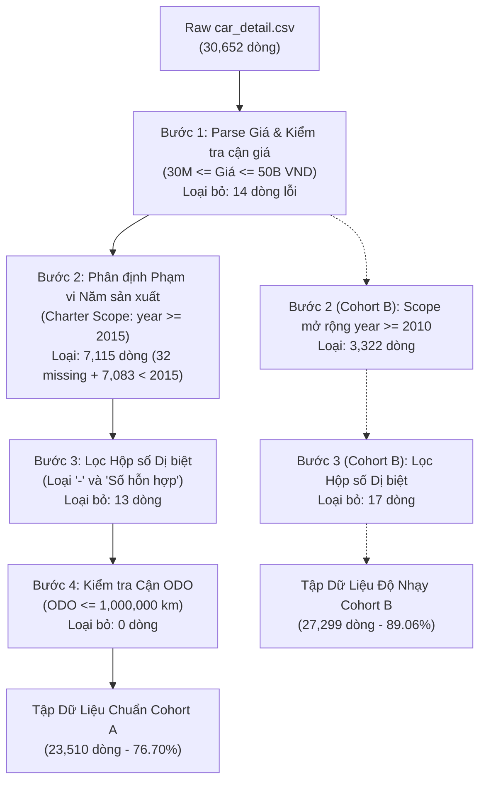

# Nhật Ký Làm Sạch Dữ Liệu (Phase 5 Data Cleaning Log)

- **Dự án**: Dự đoán giá rao bán ô tô đã qua sử dụng tại Việt Nam (Used Car Price Prediction in Vietnam)
- **Giai đoạn**: Phase 5 — Data Cleaning, Feature Engineering & Preprocessing Pipeline
- **Thời gian lập**: 19/10/2026, 03:00:00 (Múi giờ: Asia/Ho_Chi_Minh)
- **Người thực hiện**: Senior Data Scientist, ML Engineer & AI Student
- **Kịch bản thực thi**: [src/data/prepare_modeling_data.py](file:///d:/ai-club-end-training/src/data/prepare_modeling_data.py) & [src/data/cleaning.py](file:///d:/ai-club-end-training/src/data/cleaning.py)
- **Metadata**: [data/metadata/prepare_modeling_data_phase5.json](file:///d:/ai-club-end-training/data/metadata/prepare_modeling_data_phase5.json)

---

## 1. Nguồn Gốc & Kiểm Tra Tính Toàn Vẹn Dữ Liệu Thô (Raw Data Provenance & Integrity)

| Thuộc tính | Giá trị kiểm toán thực tế | Ghi chú kỹ thuật |
| :--- | :--- | :--- |
| **File dữ liệu nguồn** | `data/raw/external/mquaan_car_price/car_detail.csv` | File thô nguyên bản không bị sửa đổi |
| **SHA-256 Checksum** | `44c13afc5982f7abc51611fc56eeefd02df8e47f3224112f51b76514a7328f08` | Khớp 100% với `ingestion_mquaan_car_price.json` |
| **Dung lượng file** | 21,355,297 bytes (~20.36 MB) | Bất biến (Immutable) |
| **Tổng số dòng thô** | **30,652 dòng** | Đầy đủ dữ liệu thu thập |
| **Tổng số cột thô** | **21 cột** | 100% tiếng Việt từ tin rao Bonbanh.com |

---

## 2. Nhật Ký Lọc Dữ Liệu Từng Bước (Step-by-Step Data Filtering Audit)

Quy trình làm sạch được thực hiện tuần tự và độc lập bằng hàm `clean_dataset()` trong `src/data/cleaning.py`:

### Bảng theo dõi số lượng dòng qua từng bước lọc:

| Bước xử lý | Điều kiện lọc / Chuẩn hóa | Số dòng trước | Số dòng bị loại | Tỷ lệ loại (%) | Số dòng còn lại | Tỷ lệ giữ lại lũy kế (%) |
| :--- | :--- | :---: | :---: | :---: | :---: | :---: |
| **0. Raw Ingestion** | Đọc toàn bộ dữ liệu thô | - | 0 | 0.00% | 30,652 | 100.00% |
| **1. Target Validation** | Giá VND hợp lệ trong $[30\text{ triệu}, 50\text{ tỷ}]$ | 30,652 | 14 | 0.05% | 30,638 | 99.95% |
| **2. Cohort Year Scope** | Năm sản xuất $\ge 2015$ (Charter Scope) | 30,638 | 7,115 | 23.22% | 23,523 | 76.74% |
| **3. Transmission Cleaning**| Loại bỏ ký tự rác (`-`, `Số hỗn hợp`) | 23,523 | 13 | 0.06% | 23,510 | 76.70% |
| **4. Mileage Validation** | $0 \le \text{ODO} \le 1,000,000\text{ km}$ (giữ ODO=0) | 23,510 | 0 | 0.00% | **23,510** | **76.70%** |

> [!IMPORTANT]
> **Phân loại rõ ràng giữa Lỗi Dữ Liệu (Data Error) và Ngoài Phạm Vi (Out-of-Scope)**:
> - **Lỗi dữ liệu thực sự (Data Errors)**: Tổng cộng chỉ có **14 dòng** (1 xe báo giá 12 triệu VND không thực tế, 13 dòng có giá trị hộp số dị biệt không thể phục hồi).
> - **Ngoài phạm vi nghiên cứu (Out of Scope)**: **7,115 dòng** (bao gồm 32 dòng khuyết năm sản xuất và 7,083 dòng xe sản xuất trước năm 2015). Đây không phải là dữ liệu sai, mà là các xe nằm ngoài đề cương nghiên cứu được phê duyệt trong Project Charter.

---

## 3. Chính Sách Xử Lý Giá Trị Khuyết Thiếu (Missing-Value Handling Policy)

Nhóm áp dụng nguyên tắc **Zero Data Leakage** — không thực hiện bất kỳ phép imputation nào (median, mode, mean) trên toàn bộ tập dữ liệu tại giai đoạn Cleaning:

| Trường dữ liệu | Tỷ lệ Missing trong Cohort A | Phân loại | Chính sách xử lý tại Cleaning | Xử lý tại Preprocessing (Train/Test) |
| :--- | :---: | :--- | :--- | :--- |
| `price_vnd` (Target) | 0.00% | Target | **Loại bỏ bản ghi nếu khuyết target** (Không bao giờ impute target bằng 0 hoặc median). | Đã được lọc sạch tại Cleaning. |
| `year` | 0.00% | Feature chính | **Loại bỏ nếu khuyết** (Năm là tiêu chí xác định scope). | Không có missing. |
| `transmission` | 0.00% | Feature phân loại | **Loại bỏ nếu giá trị dị biệt** (`-`, `Số hỗn hợp`). | Không có missing. |
| `mileage_km` | 0.00% (sau clean) | Feature định lượng | **Giữ nguyên 10,442 xe ODO = 0**, gán cờ `is_zero_mileage=1`. Sentinel $\ge 1,000,000$ chuyển thành NaN. | Median Imputer + Indicator nếu có test missing. |
| `engine_displacement_l`| 4.28% (1,006 dòng)| Feature định lượng | **Giữ nguyên NaN**. Không loại bỏ dòng xe chỉ vì thiếu dung tích động cơ. | `SimpleImputer(strategy='median', add_indicator=True)` trên tập Train. |
| `fuel_type` | 0.00% | Feature phân loại | Trích xuất thành công 100% từ chuỗi mô tả động cơ. | `OneHotEncoder(handle_unknown='ignore')`. |
| `seats` / `doors` | 0.00% | Feature định lượng | Bóc tách từ regex, đầy đủ trên tập Cohort A. | Không cần imputer (hoặc fallback median). |
| `Hệ thống nạp nhiên liệu`| 78.53% (18,473 dòng)| Feature tùy chọn | Giữ nguyên trong bảng audit, **loại khỏi feature matrix mô hình** do tỷ lệ thiếu quá cao (>75%). | Loại bỏ khỏi danh sách features $X$. |

---

## 4. Xử Lý Các Trường Hợp Đặc Biệt (Edge Cases Handling)

1. **Xử lý 10,442 xe có ODO = 0 km**:
   - Đối chiếu với trường `Tình trạng`, phát hiện 6,070 xe có tình trạng `'Xe mới'` (chiếm 58.1% số xe ODO=0) đang được các showroom/đại lý chào bán nguyên bản.
   - Nhóm 4,372 xe `'Xe đã dùng'` có ODO=0 phản ánh hành vi người bán không điền số kilomet thực tế hoặc quy ước mặc định trên sàn giao dịch.
   - **Giải pháp**: Giữ nguyên giá trị `0` trong `mileage_km`, đồng thời tạo cờ nhị phân `is_zero_mileage = 1`. Điều này giúp các mô hình (Linear, Tree) học được trọng số riêng cho hiệu ứng "xe mới / không khai báo ODO" mà không làm méo mó độ dốc khấu hao của các xe có ODO thật.

2. **Xử lý xe sang và Outliers giá cao**:
   - Giá cao nhất trong Cohort A là **47 tỷ VND** (Rolls-Royce Phantom VIII, năm 2021).
   - Kiểm tra chéo thị trường cho thấy mức giá 40 - 50 tỷ VND đối với Rolls-Royce/Bentley lướt là hoàn toàn có thật và hợp lý.
   - **Giải pháp**: Tuyệt đối không xóa các xe này như một ngoại lai thống kê. Nhóm bổ sung cờ `is_luxury_brand = 1` và áp dụng biến đổi hàm mục tiêu `log_price = ln(price_vnd)` để triệt tiêu độ lệch dương (positive skewness).

---

## 5. Danh Sách Tập Dữ Liệu Đã Xuất Bản (Artifact Outputs)

1. **Tập dữ liệu chính (Primary Modeling Candidate)**:
   - File: [data/processed/cars_clean_phase5.csv](file:///d:/ai-club-end-training/data/processed/cars_clean_phase5.csv)
   - Quy mô: **23,510 dòng**, **38 cột**
   - Checksum SHA-256: `eee548dfe3f456ad6d4a9a0c51dc71df8a45823d139d9e28d372039c65cd46d5`
2. **Tập dữ liệu độ nhạy mở rộng (Extended Sensitivity Dataset)**:
   - File: [data/processed/cars_clean_phase5_cohort_b.csv](file:///d:/ai-club-end-training/data/processed/cars_clean_phase5_cohort_b.csv)
   - Quy mô: **27,299 dòng**, **38 cột**
   - Checksum SHA-256: `910badfeac2219e15ce5a436fbc9f439bc79258f6652600b04f60cd63b4b3c46`
3. **Metadata Ingestion & Preparation**:
   - File: [data/metadata/prepare_modeling_data_phase5.json](file:///d:/ai-club-end-training/data/metadata/prepare_modeling_data_phase5.json)
